# niche-lab v2.1.0

**Give Claude a resume and a LinkedIn profile. Get back the 3–10 job-market niches that fit, each measured against live postings; one tailored resume per niche; a rewritten LinkedIn profile; and an interactive report: a star map of the market with the candidate placed on it.**

Works for any profession. Nothing in the method assumes a job family: the core requirement codebook is profession-neutral, and when no module fits, the run induces one from the postings it collects and checks it with a blind second coder.

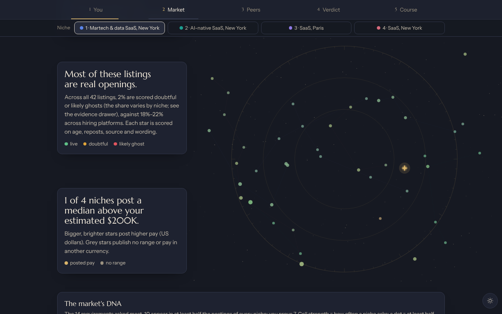

## Use it

| Where | How |
|---|---|
| Claude Code (plugin) | `claude plugin marketplace add <this repo>` → `claude plugin install niche-lab@niche-lab` → type `/niche-lab:run` |
| Claude app (skill) | `make dist`, upload `dist/niche-lab-skill.zip` as a custom skill, then say "run niche-lab" |
| Any Claude chat with file tools | drop the repo zip in and say "run niche-lab"; [`START_HERE.md`](START_HERE.md) tells Claude what to do |

Claude asks one question: your resume and your LinkedIn profile, as LinkedIn's PDF export (More → Save to PDF) or pasted text. A LinkedIn URL alone gets one fetch attempt; LinkedIn usually blocks it, and the run continues resume-only with the LinkedIn rewrite built from the resume. Everything else is researched. What cannot be inferred becomes a `[placeholder]` and a line in the report's confirm list.

The run needs web search and page fetch. Without them it stops at preflight and says so, because a niche study without live postings would be invented.

## What you get

The report is a journey in five acts, each opening with the question it answers. The same star map runs through it: every posting a star, every niche a constellation, you in gold.

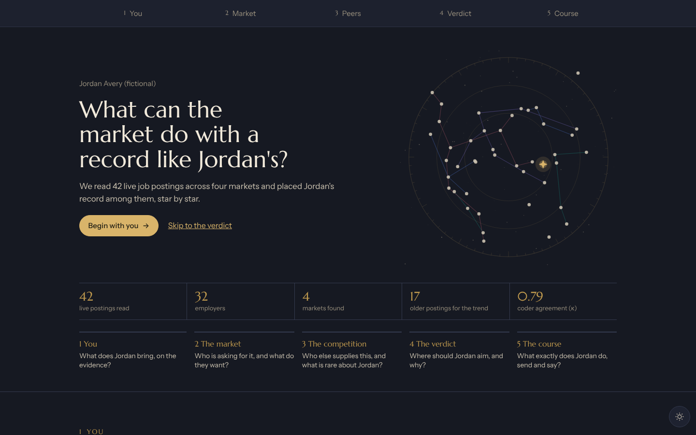

| | |
|---|---|
| 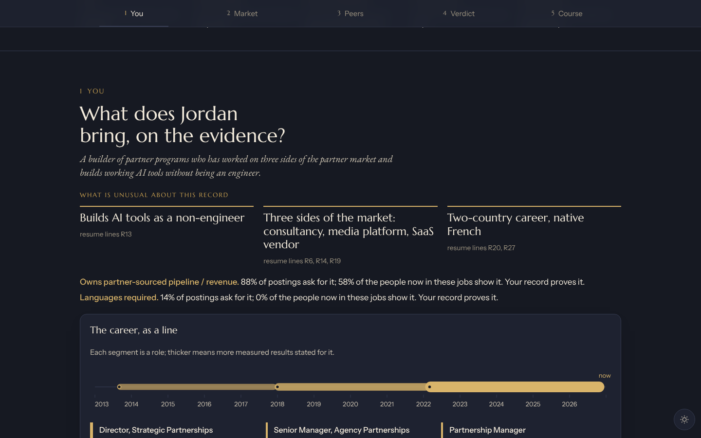 | **1 · You.** What the record proves, on the evidence: the career as a line through time, what is unusual about it, every inferred field with its confidence and resume line, and how the current resume reads in its first six seconds. |
|  | **2 · The market.** The niches as constellations, recoloured by ghost-job risk and by pay; the requirement matrix across niches; the demand map with 95% intervals. Behind the evidence drawers: what rises with seniority, niche against niche, then against now, job-title shifts, requirement bundles, the phrases employers repeat, posted pay ranges. |
| 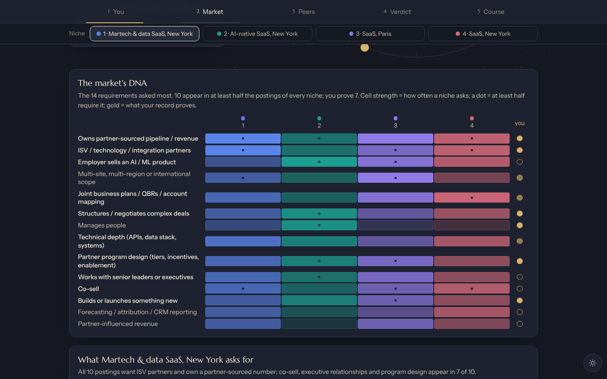 | **The market's DNA.** The 14 requirements asked most, by niche, with what you prove in gold. |
| 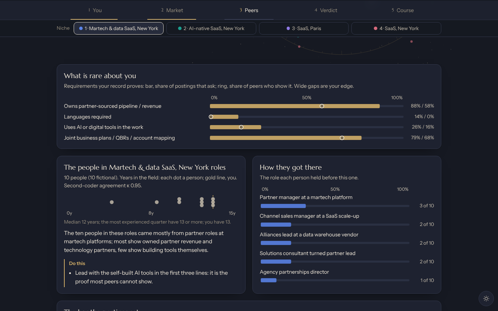 | **3 · The competition.** People already in these jobs, found in public hire announcements, team pages and speaker bios: their years, the paths they took, and what is rare about you (asked by postings, rarely shown by peers). |
| 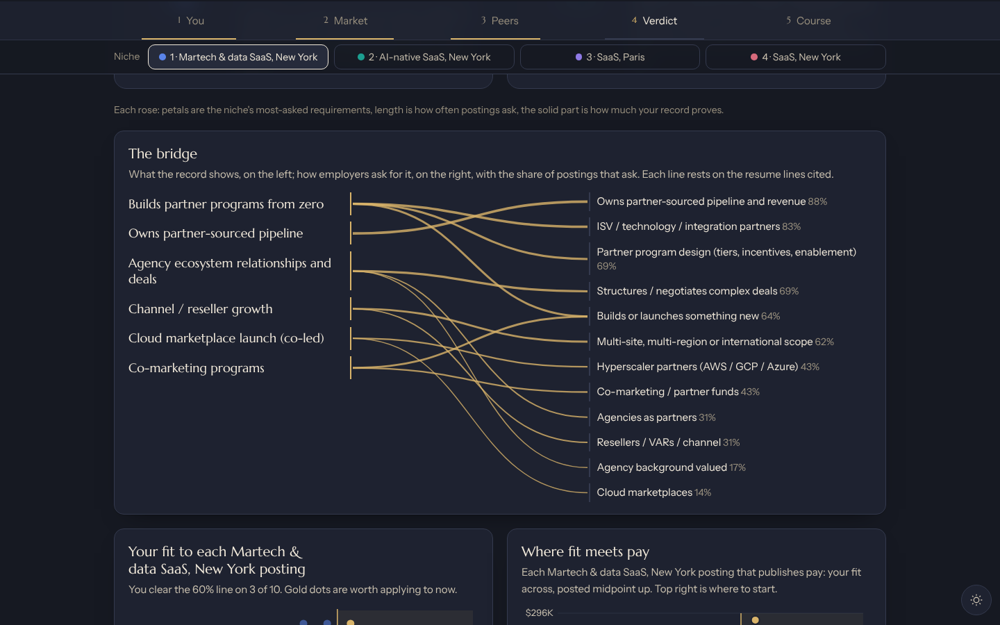 | **4 · The verdict.** Three findings, the niches to run now, the bridge from your strengths to the way employers ask for them, fit to each posting and fit against pay. |
| 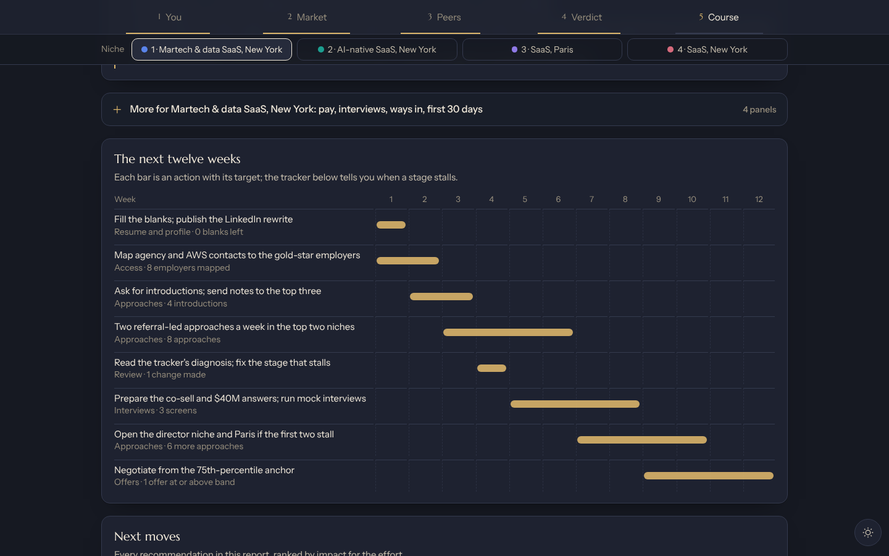 | **5 · The course.** The next twelve weeks, the pitch, who to approach first with drafted notes, ranked actions, golden sentence formulas, one resume per niche, the LinkedIn rewrite, a search tracker, and a blind panel's verdict on old against new. |

Phone and light mode:

| 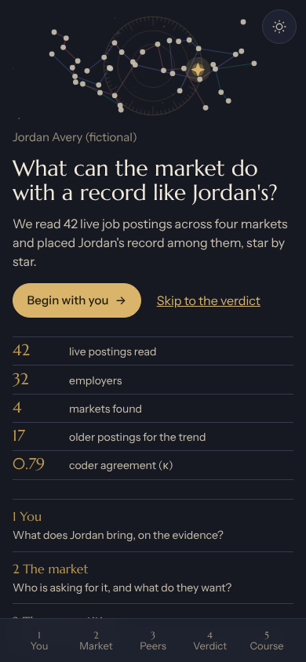 | 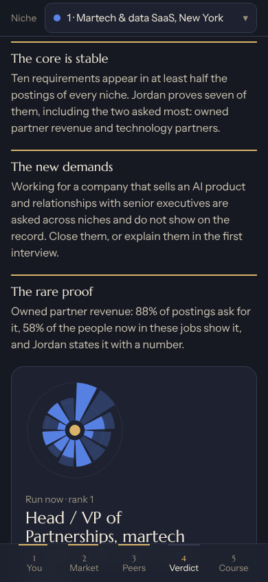 | 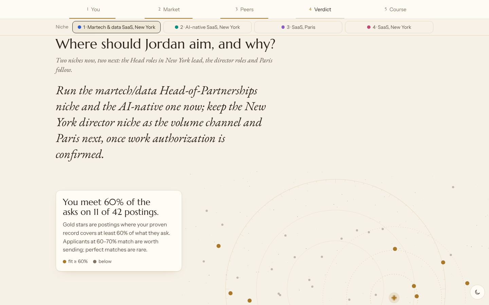 |
|---|---|---|

Layout is enforced by tests, not by eye alone: no sideways scrolling, no text outside its box, no truncated label, equal-width aligned buttons, 44 px tap targets on phones, at ten widths from 320 to 1920 px, in both themes and at 125% text. The report is one self-contained HTML file: fonts embedded (Fraunces, Schibsted Grotesk, OFL), no network calls. Full example: [`examples/fictional-candidate/report.html`](examples/fictional-candidate/report.html) (fictional candidate and peers, real 2026 postings).

## How it works

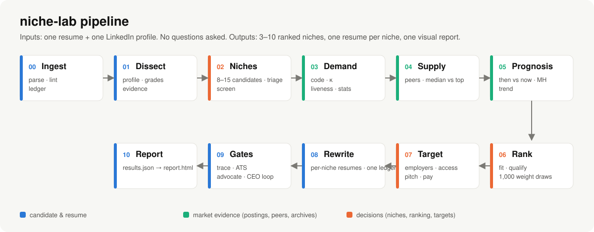

| Phase | What happens |
|---|---|
| 0 Preflight + ingest | Capability check (web, fetch, subagents, PDF tools, Chrome); text extraction with pypdf / python-docx fallbacks; two-column repair; language detection; every line numbered into a fact ledger |
| 1 Dissect | Role family, seniority band (six generic bands), segment, pay estimate, strengths, disclosure risks, each with a confidence grade and ledger ids |
| 2 Niches | 8–15 candidate niches, one dimension varied at a time; screened to 3–10 |
| 2b Codebook | Pick a module or induce one from the postings; validate; second-coder κ reported |
| 3 Demand | Full posting text stored and coded; Wilson CIs, lift, keyness, bootstrap pay, liveness score per posting |
| 4 Supply | People now in the jobs from public announcements, team pages and speaker bios (≥ 8 per niche), coded on the niche codebook with a second coder |
| 5 Prognosis | Earlier postings vs now (Fisher, Cochran–Armitage, Mantel–Haenszel by band); seniority and niche-vs-niche contrasts with a small-sample rule; job-title shift |
| 6 Rank | Fit, qualification, opportunity score; robustness under 1,000 random weightings; baseline gates on the original resume |
| 7 Target | Employers, access paths, pitch, pay anchor and script |
| 8 Rewrite | One resume per niche from the shared ledger |
| 8b LinkedIn | Rewrite plus five gates: field limits, consistency with resumes, traceability, authenticity, hook |
| 9 Gates | Deterministic gates, rendered-PDF ATS parse, advocate test, three independent reviewer agents, a blind old-vs-new panel |
| 10 Report | `results.json` → atlas; the build fails if any action lacks impact, effort or a section |

Plugin layout: [`skills/run/SKILL.md`](skills/run/SKILL.md) routes to [`phases/`](skills/run/phases/), 21 [`rubrics/`](skills/run/rubrics/), [`prompts/`](skills/run/prompts/), [`codebooks/`](skills/run/codebooks/) and the sourced [`rulebook/`](skills/run/rulebook/). The five reviewer and coder subagents in [`agents/`](agents/) are generated from the prompts by `make agents`.

## Develop

```bash
pip install -r skills/run/requirements.txt   # numpy scipy statsmodels pyyaml jsonschema pypdf python-docx
python3 -m playwright install chromium        # UI tests and PDF rendering
make test                                     # full suite
make example                                  # rebuilds the example report end to end
make dist                                     # dist/niche-lab-skill.zip for the Claude app
claude plugin validate .
```

If pip is blocked in the Claude session, preflight reports it and the run falls back: pypdf when pdftotext is missing, python-docx when pandoc is missing; without Chrome the ATS parse gate is reported `not_run` rather than passed.

## Status and limits

- **Tested here:** the full test suite, including offline end-to-end runs on synthetic nursing, civil engineering and restaurant management candidates with generated postings (the evidence for the any-profession claim), a French resume for language handling, a layout auditor run over 10 widths × 3 fixtures × both themes × 125% text (itself tested against planted defects), a parity check that every figure of the original study renders, the original study's seniority statistics reproduced on the same postings, the three real test resumes' career data through the layout checks, plugin validation, and a privacy scan that keeps real candidate data out of the repo. Details: [`docs/acceptance.md`](docs/acceptance.md).
- **Not tested here:** installing from the marketplace in a fresh Claude Code session; uploading the zip in the Claude app; the raw-zip START_HERE flow; live runs with real web-collected postings for new professions (target: second-coder κ ≥ 0.6); the report inside the mobile app's viewer.
- **LinkedIn** blocks automated reads, so the peer phase depends on public announcements, team pages and speaker bios, and the profile input should be the PDF export or pasted text. In professions that rarely announce hires the competition act often falls back to rarity against postings.
- **The blind panel** plays three readers in one reviewer session and says so; in the example, two of three preferred the original because the new versions still had blanks to fill.
- **Career dates** parse reliably from real resumes; job titles on two-column PDFs can land on the company line until phase 0's ledger correction fixes them.
- **Small corpora:** niches under 30 postings are flagged low confidence; the example relaxes volume thresholds and says so in a banner.
- **Inferred, not asked:** pay floor, preferences and access paths come from the record and public data; they carry low weights and land in the confirm list.
- **Demand size is an index,** not a count of openings.
- **Cost:** a 5-niche run codes roughly 150–250 postings; one subagent per niche.

Sources: [`skills/run/rulebook/sources.md`](skills/run/rulebook/sources.md).
